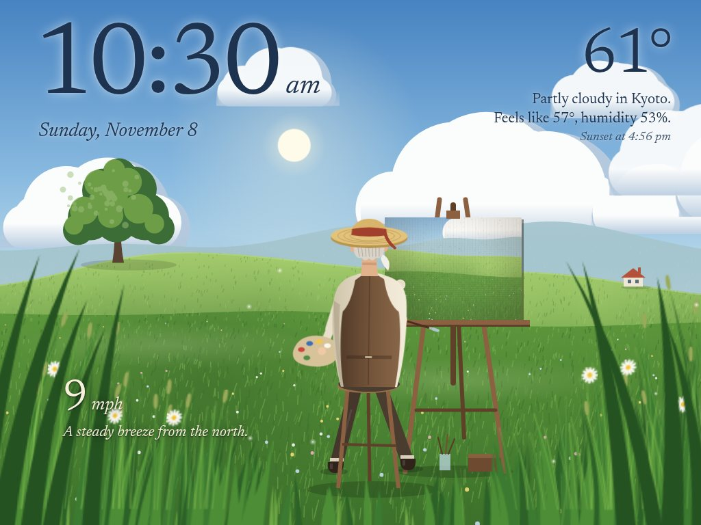
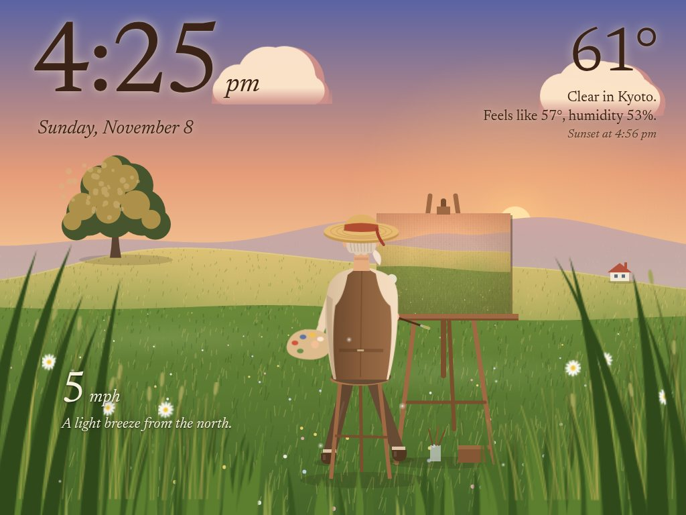
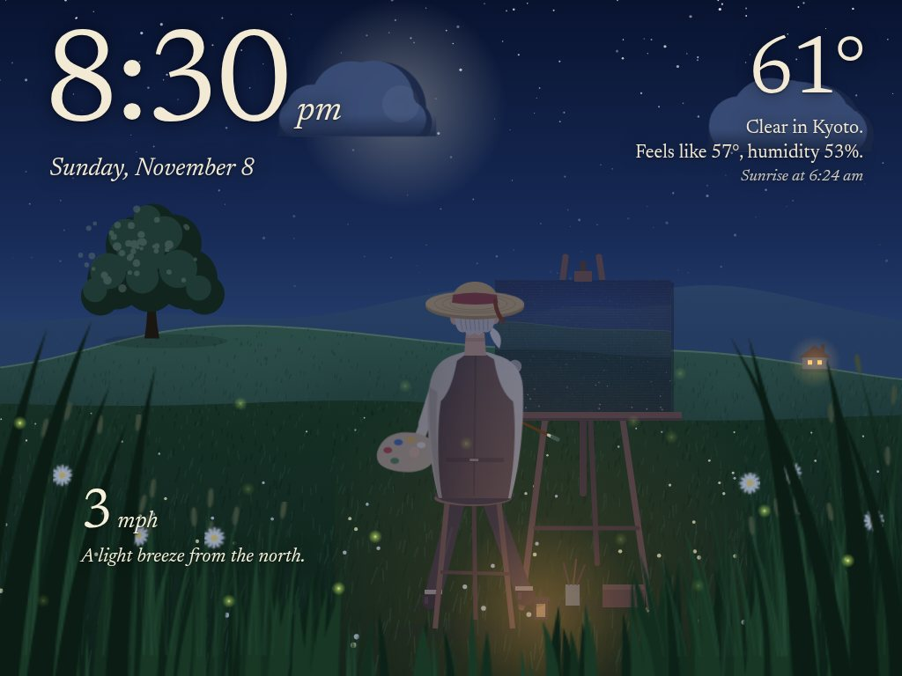
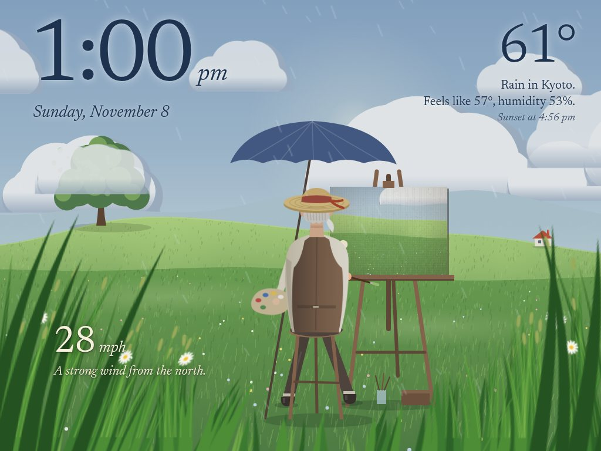

# iPad panel

A wall and desk display for an old iPad that can't run modern apps. It shows
the time, live weather, your photos and your smart-home controls. Its showpiece
is the *painter's meadow*: a storybook field, drawn entirely in code, where an
old painter paints your photos stroke by stroke while the grass sways with the
real wind outside.

**[Try the meadow in your browser](demo/)**, or **[the city](demo/city.html)**:
change the wind, the weather, the time of day and the date, or give them your
own photos (they never leave your device). In the city you can also call the
dog, play fetch, wake the cat and ring the doorbell. Each page links to the other and keeps your
settings when you switch.
How it came together, and how it runs on a 2012 iPad, is in
[docs/STORY.md](docs/STORY.md).

| Golden hour | Night | Rain |
|---|---|---|
|  |  |  |

## How it works
A small Python server (standard library only, plus Pillow for photos) runs on
any computer on your network, later a Raspberry Pi. The iPad just opens a web
page, so no jailbreak or app is needed. Everything the iPad runs is plain ES5
JavaScript and iOS 9-safe CSS, so it works on the original iPad mini
(iOS 9.3, 512 MB of RAM).

- **Meadow scene.** Hills, a tree, a cottage and an old painter at his easel,
  all drawn with canvas code. He paints one of your photos at a time: a blurry
  block-in, then shapes, then detail, with his arm following the brush. A new
  painting every 2 minutes.
  - The foreground grass sways with the live wind speed and direction. The hat
    ribbon, the clouds, drifting seeds and light rippling over the field
    follow it too.
  - The sun sits where it really is in your sky, computed from the time and
    your location. It rises on the left and sets behind the hills on the right.
    The moon does the same, in its real phase, with its lit side toward the sun.
  - The seasons follow the date: blossom in spring, a tree that turns gold and
    red in fall and drops its leaves on the wind, a bare tree and a straw-coloured
    field in winter.
  - Golden hour, night (lantern, fireflies, a lit cottage window), rain (an
    umbrella), fog, snow and storms each look different.
- **City scene.** A corner apartment high above Manhattan. From 1 am to 8 am
  he's asleep by the east window (with the cat), and the real sunrise comes up
  over the East River. The rest of the day he's at his desk by the west window,
  typing the scene's own code on one monitor and editing your photos on the
  other, while the real sunset drops behind the Hudson and the towers light up.
  The time and weather sit over the scene as in the meadow, and the time also
  glows on a digital clock on his desk and by the bed. Every so often a golden
  retriever wanders through and sniffs the rug, chases its tail, comes to sit
  by his chair to be petted, or plays fetch: it brings the ball back, he takes
  it and throws it again. At night it sleeps on its bed by his. The cat naps on
  the desk, and every few minutes wakes, stretches, washes and walks over
  (across the keyboard, which types for it; he lifts his hands) to be petted,
  then goes home behind the keyboard, kneads and curls up. Both are drawn from
  simple skeletons, so paws stay planted as they walk and they turn round
  through a frame facing you. `cat=1` sends the cat more often. The camera pans across
  the apartment when he gets up or turns in.
- **Photo scene.** A slideshow of your photos with a slow pan and zoom, under
  a time-of-day tint and animated weather.
- **Both scenes** show the time, date, temperature, feels-like, humidity,
  sunrise or sunset, a 4-day forecast, and a message banner you can set from
  any device on your network. Under the date: US National Weather Service
  warnings for your location, the doorbell, and your next calendar event.
  Under the sunrise: a rain or snow heads-up for the next three hours
  ("Rain from about 3:15 pm"), and the air quality when it isn't good.
- **The scenes follow the world outside.**
  - Poor air puts a haze over the land and the skyline, and wildfire smoke
    (an index over 150) turns the sky orange-brown, as it did over New York
    in June 2023.
  - Holidays: a carved pumpkin, lit after dark, on the desk, the windowsill
    and in the meadow from October 17; coloured string lights, a little tree,
    lights on the meadow tree and the cottage, and snow on the cottage roof
    from December to January 6; fireworks over the river and the hills on
    the Fourth of July (9:15 to 10:30 pm) and at midnight on New Year's Eve.
  - Home Assistant events: when the doorbell rings the dog gallops to the
    door and barks, and he turns round to look; a door opening gets a trot.
    A new message is stuck to his monitor as a note, and he glances at it.
  - On the iPad, tap the sleeping cat to wake it, or tap the floor to call the
    dog (fetch and a visit, in turn).
- **Home controls.** Tiles for lights, switches, fans, covers, locks, climate,
  media players and sensors from Home Assistant.
- **Computer breakdown.** Tap the computer stats for per-core load and clock
  speed, memory, disks, temperature sensors, network and the busiest programs
  (Linux only, read from `/proc` and `/sys`).

## Getting started
1. On the computer that will serve the panel:

       pip install pillow
       cp config.example.json config.json   # set place_name, latitude, longitude
       python3 server.py                    # serves on port 8765

2. On the iPad, join the same Wi-Fi and open `http://<server-ip>:8765` in
   Safari. Then:
   - Share > Add to Home Screen, and launch it from the icon so it runs full
     screen.
   - Settings > Display & Brightness > Auto-Lock > Never.
   - Settings > General > Accessibility > Guided Access > On. Open the panel
     and triple-click Home to lock the iPad to it.
3. Give the server a fixed address in your router (a DHCP reservation) so the
   iPad always finds it.

To start the server on boot with systemd:

    cp ipad-panel.service ~/.config/systemd/user/
    systemctl --user daemon-reload
    systemctl --user enable --now ipad-panel
    sudo loginctl enable-linger $USER   # keep it running when logged out

## Configuration (`config.json`)
| Key | What it does |
|---|---|
| `place_name`, `latitude`, `longitude` | Weather location (from [Open-Meteo](https://open-meteo.com/), no key needed) and the sun's position |
| `units` | `"fahrenheit"` or `"celsius"`. The iPad can switch too, and remembers it |
| `scene` | Starting scene: `"meadow"`, `"city"` or `"photos"`. Links at the top switch scenes on the iPad |
| `city.sleep_hour`, `city.wake_hour` | When he's in bed in the city scene (default 1 and 8, local hours) |
| `photos.dirs` | Folders of JPG, PNG or WebP photos. Images under 800px are skipped; HEIC isn't supported |
| `photos.seconds_per_photo` | Slideshow speed in the photo scene (default 5) |
| `photos.seconds_per_painting` | How long each painting stays up in the meadow, and each photo edit in the city (default 120) |
| `night_dim_start_hour`, `night_dim_end_hour` | Dims the screen overnight (and slows the animation to save power) |
| `disks` | Which drives the computer stats show, e.g. `{"path": "/home", "label": "Home"}` |
| `home_assistant` | `enabled`, `url`, `token_file`, and the `entities` to show as tiles |
| `calendar` | `ics`: one or more private iCalendar links (in Google Calendar: Settings > your calendar > Secret address in iCal format) or file paths; `days` to look ahead (default 3). Daily, weekly, monthly and yearly repeats are understood |
| `presence` | Home Assistant `person` or `device_tracker` entities. When all of them are away, the panel dims as it does overnight |
| `scene_events` | `doorbell` and `door` lists of Home Assistant entities (binary sensors or event entities) that the city's dog reacts to |
| `charger` | A Home Assistant smart plug the iPad charges from: `entity`, `on_minutes`, `off_minutes` (default 120 and 120). See below |
| `watchdog` | Notifies you when the iPad stops checking in for `minutes` (default 15), and again when it's back: through the Home Assistant service in `notify` (e.g. `notify.mobile_app_your_phone`; default: a notification in Home Assistant) and/or an [ntfy](https://ntfy.sh) topic URL in `ntfy` |
| `air_quality`, `weather_alerts` | Set to `false` to hide the air quality or the weather warnings |

Photos are resized to 1600px (with EXIF rotation) and cached in
`~/.cache/ipad-panel/photos`, so the iPad never decodes a full-size phone photo.

Set or clear the message banner from any device on your network:

    curl -d 'Laundry is done' http://<server-ip>:8765/api/message
    curl -X DELETE http://<server-ip>:8765/api/message

## Looking after the iPad
An old iPad that charges around the clock is the panel's main risk: a worn
lithium battery kept full can swell and push the screen out. Safari can't
read the battery level, so the server cycles a smart plug by the clock
(`charger` above), keeping the battery between full and part-empty. Start
with 2 hours on and 2 off, and lengthen the off time if the battery lasts.
If the iPad stops checking in (the `watchdog`), the plug is switched on and
stays on until it's back. If the screen ever starts to lift, unplug the iPad
and stop using it.

## Home controls (Home Assistant)
List entities under `home_assistant.entities`, either as `"light.kitchen"` or
as `{"id": "cover.garage_door", "name": "Garage"}` to rename a tile. Only listed
entities can be read or controlled. The Home Assistant token stays on the server
in `ha-token.txt` (create it with a long-lived token from your Home Assistant
profile), and the iPad never sees it. Locks and garage doors ask for
confirmation before opening.

`ha-dev/docker-compose.yml` runs a throwaway Home Assistant with demo devices,
for trying the tiles without real hardware.

## Moving to a Raspberry Pi
1. Raspberry Pi OS 64-bit, a DHCP reservation for the Pi, and Docker.
2. Copy this folder over and install the systemd service as above.
3. Run Home Assistant with Docker (`ha-dev/docker-compose.yml` is a start: point
   its volume at a fresh config folder and remove `demo:`).
4. Create a long-lived access token in Home Assistant, save it to
   `ha-token.txt`, and list your real entities in `config.json`.
5. Point the iPad at `http://<pi>:8765`. For Zigbee devices, add a USB Zigbee
   adapter and Home Assistant's ZHA integration.

## Previews and debugging
- Preview any look: `/meadow.html?wx=storm&phase=night&wind=40&time=16:20`
  (wx: clear partly cloudy fog drizzle rain heavy snow blizzard storm; phase:
  day golden night; wind in km/h; `days=9` looks 9 days ahead; `season=winter`
  shows a season). `&sim=60` fast-forwards the painting by 60 seconds, and
  `&timer=1` keeps the animation running, both useful for screenshots since
  headless browsers barely animate. `holiday=halloween`, `winter` or
  `fireworks` previews the decorations, and `aqi=180` the haze of bad air. The
  photo scene takes `/?wx=…&phase=…`.
- The city takes the same options plus `view=bed` or `view=desk`:
  `/city.html?view=bed&time=6:40&wx=rain&wind=30`. `dog=visit` (or `fetch`,
  `walk`, `tail`) sends the dog in every few seconds. To try the doorbell
  without a real one, set a made-up sensor in Home Assistant (Developer
  tools > States) and list it under `scene_events`.
- Jump straight to a screen: `/#home` or `/#system`.
- The iPad has no developer console, so the page reports page loads, JavaScript
  errors and (in the meadow) its frame rate to the server log:
  `journalctl --user -u ipad-panel -f`.
- The iPad reloads by itself within 5 seconds when files in `static/` change.

## The demo
`demo/` (the meadow) and `demo/city.html` (the city) run the scenes without the
server: they fetch live weather in the browser and use photos you pick. Run
them locally with `python3 -m http.server` from this folder and open
`http://localhost:8000/demo/`, or publish the repo with GitHub Pages
(deploy from the main branch, root folder) and visit `/demo/`. The two pages
share `?wx=`, `?wind=`, `?time=`, `?days=`, `?place=&lat=&lon=` and `?unit=`.
They show the place's live air quality too (or `?aqi=180`), and the date
slider reaches the holidays. In the city you can also ring the doorbell and
leave him a note.
`static/meadow.js` explains how to embed the scene elsewhere.

## Writing for old Safari
Keep page code ES5: no arrow functions, `let`/`const`, template literals or
`fetch` (use XHR). No CSS variables or grid; use `-webkit-` prefixed flexbox.
Fonts must be WOFF, not WOFF2. Animate with CSS transforms on pre-drawn layers
rather than redrawing big canvases: the 2012 iPad mini's chip manages about
10 frames per second redrawing a full-width canvas, and 28 when the same scene
moves pre-drawn layers. [docs/STORY.md](docs/STORY.md) tells that story.

## Credits and license
Code: MIT, see [LICENSE](LICENSE). Bundled typefaces: Newsreader (Production
Type) and Big Shoulders Display (Patric King / XXIX), both under the SIL Open
Font License; the license texts are in `static/fonts/`. Weather data from
[Open-Meteo](https://open-meteo.com/) (CC BY 4.0). The meadow is inspired by
the hand-painted fields of Studio Ghibli films; this project isn't affiliated
with them.
