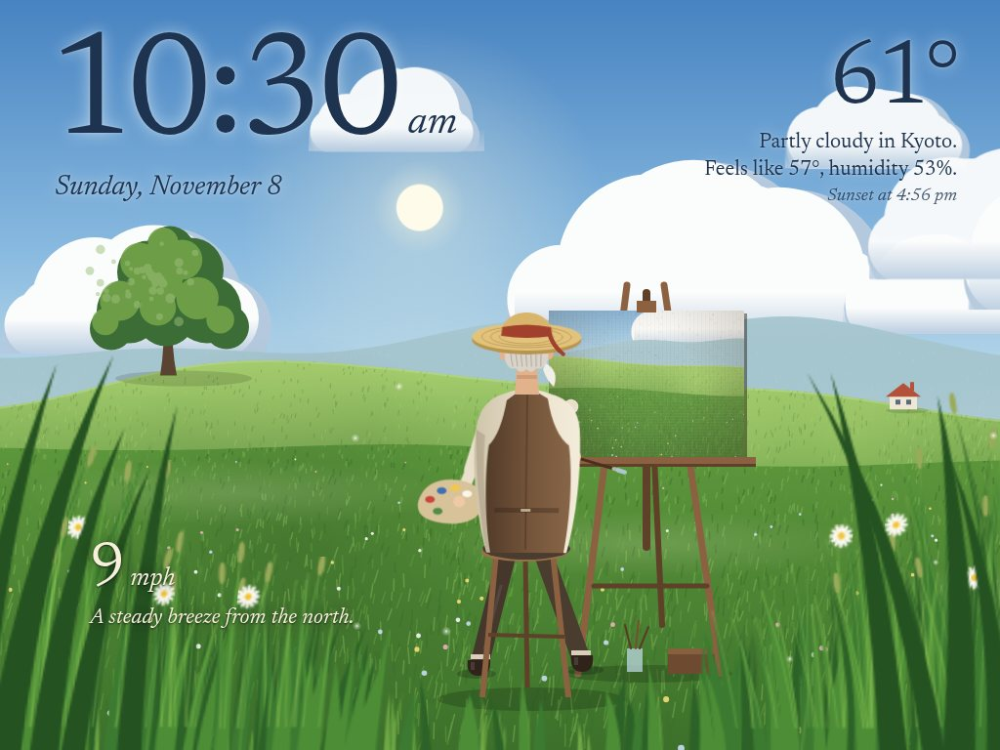
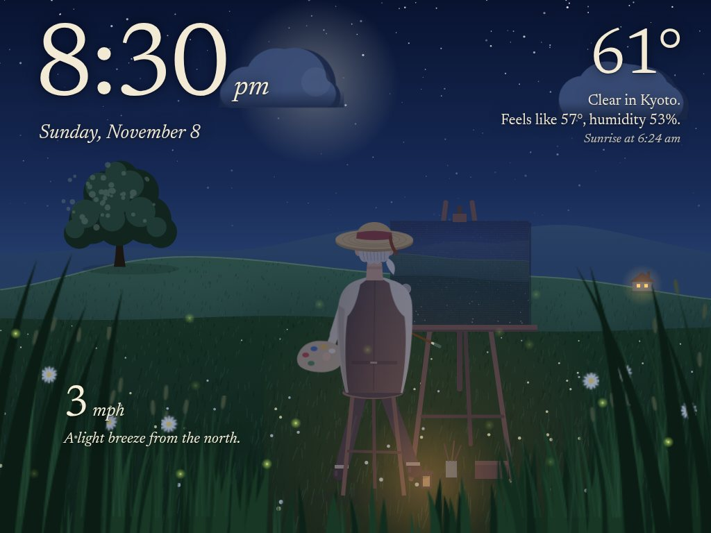
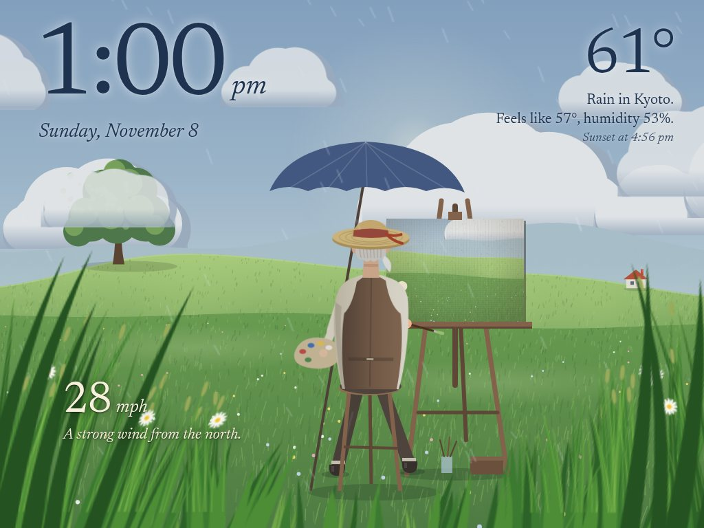

# Teaching a 2012 iPad to paint

I had an original iPad mini in a drawer. It's stuck on iOS 9.3, has 512 MB of
RAM, and the App Store has nothing left that runs on it. It still has a
perfectly good screen, so I turned it into a display panel. It ended up
somewhere I didn't expect: an old man in a windy meadow, painting my photos
one brushstroke at a time.

## No apps, just a web page

The iPad can't install anything, but it can still open a web page. So the
panel is a page served by a small Python server on my Linux desktop (a
Raspberry Pi later). The server does the heavy lifting: it fetches the weather,
resizes photos, talks to Home Assistant and reads the computer's stats. The
iPad only draws.

The catch is that the browser is Safari 9, from 2016:

- No arrow functions, `let` or `const`, template literals or `fetch`.
- No CSS variables or grid; flexbox needs `-webkit-` prefixes.
- WOFF fonts only, not WOFF2.
- 512 MB of RAM, so a full-size phone photo can take the tab down. The server
  resizes every photo to 1600px first.

There's also no developer console. When something broke, the iPad just showed
a frozen page. So the page now reports to the server: every JavaScript error,
every page load, and a status line, all landing in the server's log. That one
change made the rest of the project possible.

## Two scenes

The first scene is a photo slideshow with slow pans and zooms, the time, the
weather and a strip of computer stats. On top of the photos sits a weather
layer: rain streaks when it's raining, stars and the odd shooting star at
night, lightning in storms.

The second is the one I wanted to share: a storybook meadow inspired by the
hand-painted fields in Studio Ghibli films. Rolling hills, a big round tree, a
cottage, tall clouds on the horizon, and an old man in a straw hat at his
easel. Everything is drawn in code; there isn't a single image file.

## How he paints

Every two minutes he starts a new painting from one of my photos. I wanted it
to look painted, not faded in, so each photo is prepared three ways:

1. A very blurry copy, for the underpainting.
2. A softer copy, for shapes.
3. The full photo, for detail.

The canvas API can fill a brushstroke with an image (a "pattern"). He lays
broad horizontal strokes of the blurry copy from top to bottom, then shorter
diagonal strokes of the softer one, then dozens of small dabs of the full
photo. Thin lines along the edges of each stroke give it bristle marks. A last
glaze brings in the full photo. The new picture emerges over the old one, the
way a real painting builds up.

His arm follows the brush with simple two-joint arm maths (inverse kinematics),
and he leans toward the far side of the canvas. The tip of the brush takes the
colour he's using. Between paintings he lowers his brush and now and then
reaches up for a small touch-up.

## The weather is real

- **Wind.** Tall grass sits right in front of the camera, a little soft like an
  out-of-focus foreground. It sways faster and further as the real wind picks
  up, and leans downwind. The wind speed is written in the grass ("7 mph, a
  steady breeze from the west"). His hat ribbon, the clouds, drifting seed
  fluff and pale ripples crossing the field follow the wind too.
- **The sun.** It sits where the sun really is. The page computes its height
  and compass bearing from the time and my location (the low-precision NOAA
  formulas are well under a degree off) and faces south, so it rises on the
  left and sets behind the hills on the right. In November it barely clears the
  hills; in June it rides high. The moon gets the same treatment, in its real
  phase, with its lit side turned toward wherever the sun is.
- **The season.** The date sets how far the tree's leaves have turned, how many
  are left, and how dry the field is, on a smooth curve through the year. In
  November the tree is orange and gold and the field has gone tawny. When a gust
  reaches the tree it shakes a few leaves loose to flutter down the hill, and a
  strong gust sends big leaves tumbling past the painter, from some tree just out
  of frame. In winter the tree is bare branches; in spring it blossoms.
- **Light and weather.** Golden hour warms everything. At night he paints by
  lantern, fireflies drift through the grass and the cottage window glows. Rain
  puts up an umbrella over him, snow covers the field, and storms flash.

## From 10 frames a second to 28

The first version ran at 10 frames per second on the iPad. That's choppy for
something meant to feel gentle. I couldn't profile it on the device, so I had
the page time itself: a few seconds animating only the clouds, then only the
painter, then only the grass, then everything, posting the numbers to the
server log.

| Running | Frames per second |
|---|---|
| Nothing (just the page) | 57 |
| Clouds | 58 |
| Painter | 56 |
| Grass | 12 |
| Everything | 10 |

The grass was the whole problem. Redrawing a full-width canvas of grass blades
every frame is too much for the iPad's A5 chip. Drawing it at half resolution
helped (22 for the grass alone, and the softness suits a foreground), but not
enough.

The fix was to stop redrawing grass at all. Each tuft is now drawn once into
its own small canvas, and every frame only changes a CSS `skewX` on it. A skew
anchored at the base moves the tip of a blade more than its middle, so taller
blades swing further, like real grass. The iPad's graphics chip does that
almost for free. Grass alone went to 53 frames a second, and the whole scene to
28 while he's painting. The painter got the same treatment: his still parts are
fixed layers, his body leans with a CSS rotation, and only his arm is redrawn
each frame.

The general lesson for old devices: draw once, then move what you drew.

## Everything else

The panel also shows a 4-day forecast, a message banner I can set from my
phone with one `curl` command, Home Assistant tiles for lights, locks and the
thermostat, and a breakdown of my computer's cores, memory, disks and
temperatures.

## Try it

The meadow runs in any browser: [try the demo](../demo/). You can change the
wind and the weather, scrub through the day and the year, or give him your own photos (they
stay on your device). The code is MIT-licensed. If you have an old iPad in a
drawer, the [README](../README.md) explains how to set it up.

I built this with Claude Code as a pair programmer.
